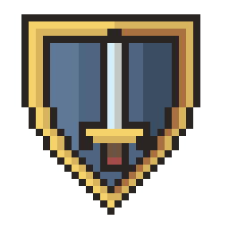
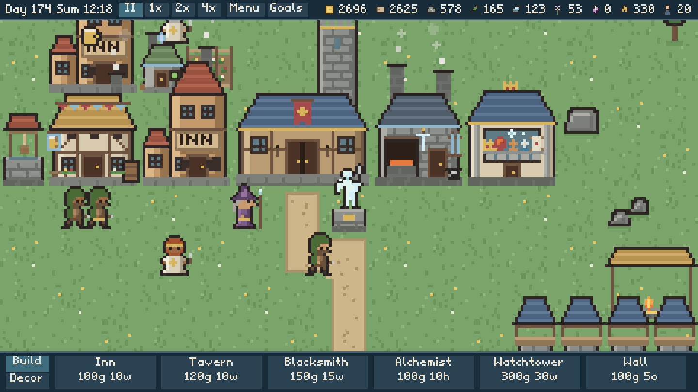
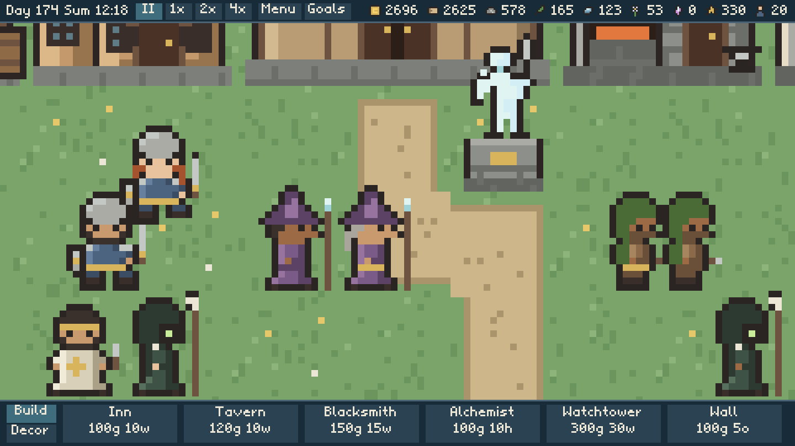
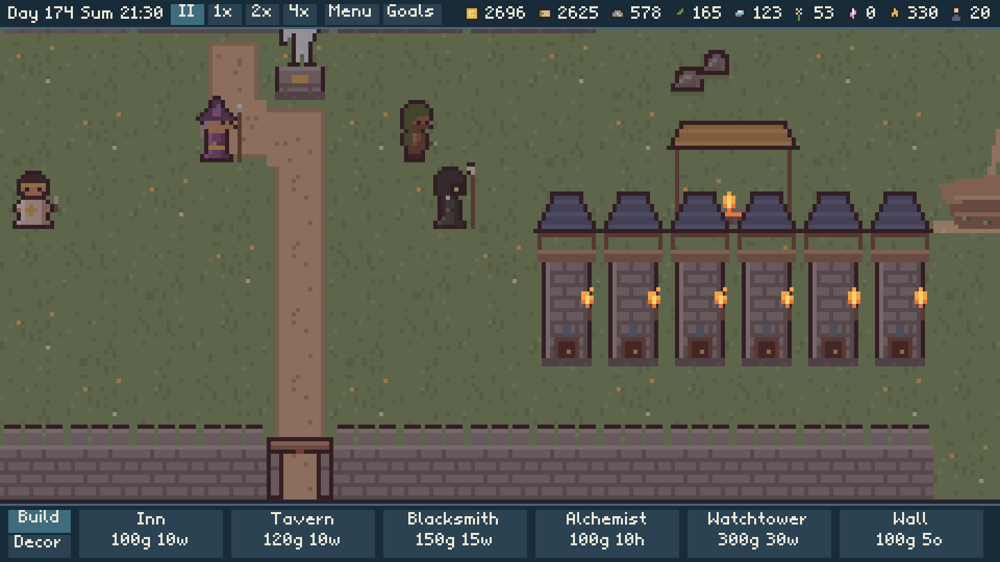
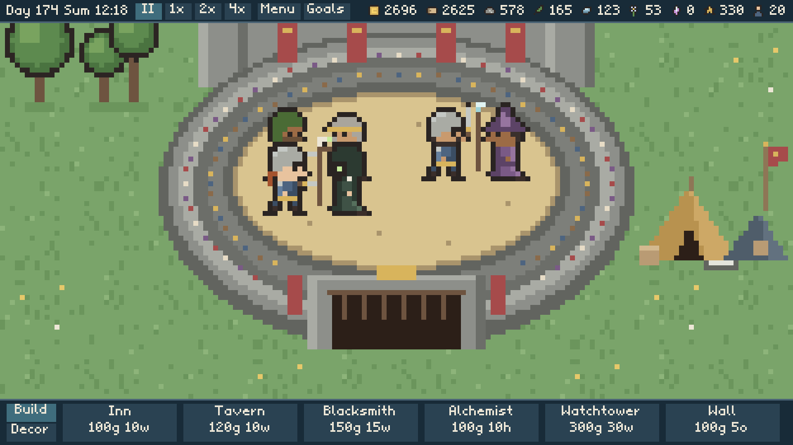
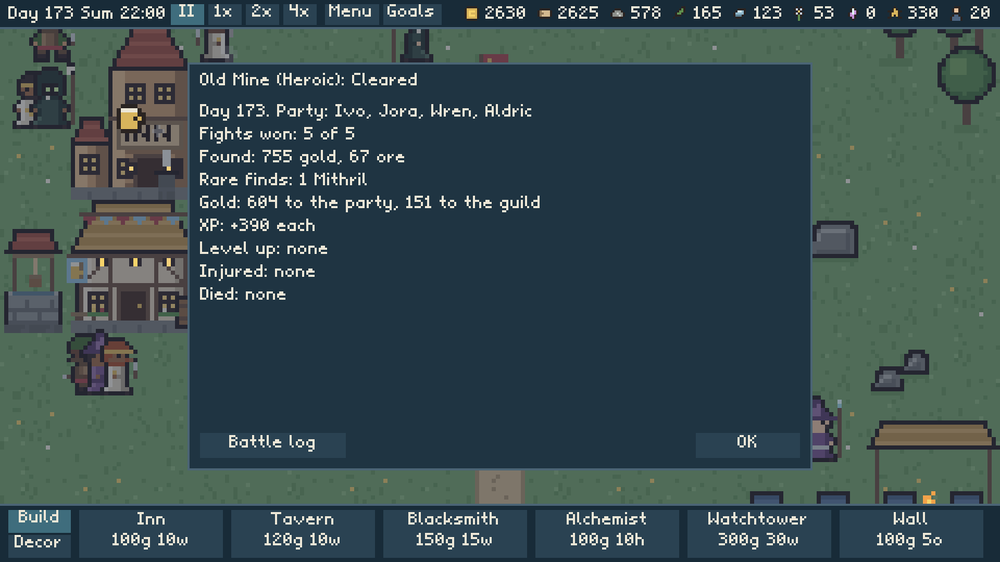
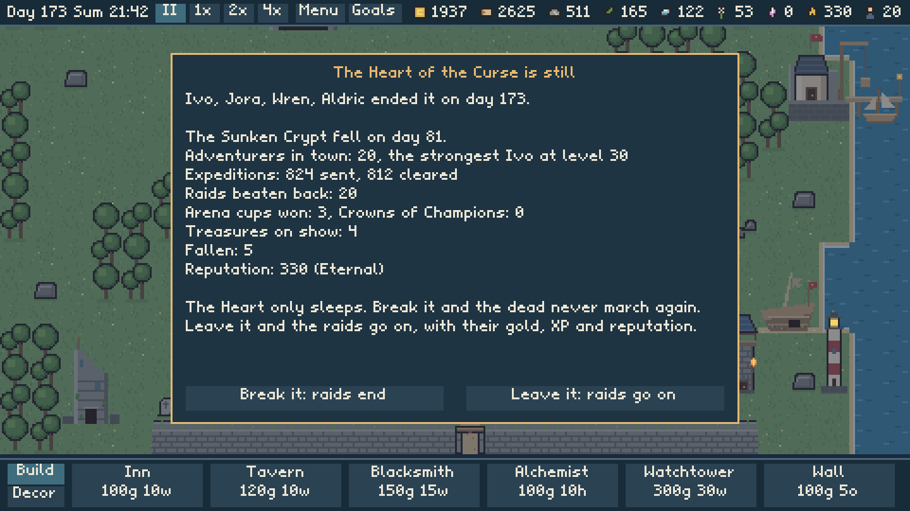

  

<h1 align="center">Guildhaven</h1>

<b>A pixel-art town management sim. Build the town, raise the heroes, send them into the dark.</b>

  

> This repository is a showcase: pictures and a description of the project. The source code is private, and
> the game is in a closed play test with friends.

## At a glance

| | |
|---|---|
| **Role** | Game designer, director and producer (solo project) |
| **Built with** | Claude Code (an AI coding assistant) writing the code, under my direction |
| **Stack** | TypeScript, Phaser 3, Vite, Vitest, Electron |
| **Time** | 31 October to 16 November 2026, about two and a half weeks |
| **Status** | Playable from start to ending; a Windows build is out with play testers |

## The game

You are the guild master of a frontier town, and you never fight yourself. You build inns, taverns, smithies and
walls; adventurers move in, buy the gear your workshops make, and go on expeditions you send them on. What they
bring back pays for the next building, and a stronger town draws stronger heroes.

The land is cursed. On raid nights the dead march on your walls, and in the end your strongest heroes go down into
the Abyss to face the Heart of the Curse, and you decide whether to break it.

- **16 buildings**, placed on a grid, where neighbours boost each other
- **5 classes:** Warrior, Mage, Rogue, Cleric and Necromancer
- **Named heroes** with traits, friendships and moods; they can die, and the town remembers them
- **Auto-resolved expeditions** to 4 dungeons and a 6-depth Abyss, against 54 enemies
- **Raids** defended with walls and watchtowers
- **An arena, a harbor, seasons, town events and 40 guild goals**
- **An ending** with a choice in it

## How it was made, and what I did

I made Guildhaven with Claude Code, an AI assistant that writes and runs code. I did not type most of the code
myself. My work was the part an AI cannot do on its own: deciding what the game is, judging whether it is fun, and
keeping a fast-moving project in order.

**Design and direction.** I set the vision, the core loop and the rules the project follows (game logic separate
from drawing, all content in data files, everything tested). Every feature started as a decision of mine, and most
changes started from something I noticed while playing. Some examples:

- **Walls and watchtowers.** In play, a line of watchtowers made raids trivial, and the wall looked odd with gaps
  in it. I asked for a tower limit, a wall you can build along the whole front, and the same total defence bonus
  once the wall is complete, with walls costing more to keep them fair.
- **Reputation.** I questioned whether reputation should keep climbing by itself. We settled on daily gain that
  stops at 50, so going higher needs real achievements: statues, cleared dungeons, treasures on show.
- **Rare gear.** Upgrading rare gear let one party clear the whole Abyss. I chose to make rare gear un-upgradable
  instead of weakening the Abyss, so the endgame stays a challenge.
- **Readability.** Squads were hard to tell apart, so each squad got its own colour that makes its members stand out.
- **Music and art direction.** I asked for a fantasy tavern feel in the music, and kept the original placeholder
  tunes as a hidden reward for finishing the game. When the hero sprites were redrawn, I had the old ones kept
  behind a setting, so the new look could be judged side by side before deciding.

**Playtesting and balance.** I played the game throughout and turned "this feels wrong" into concrete changes. To
check balance faster than one person can play, the project has bots that play 24 whole towns from day one to the
ending and report how long each stage takes; I used those numbers to decide what to change.

**Shipping.** I decided when the game was ready for other people: first a short set of hints for new players,
then a Windows app with real save files, a version number and an error screen, so testers' reports can be acted on.

**Working with an AI.** Most of the job was writing clear requests, reviewing the result in the game, and deciding
what comes next. I asked for plans before big features, made the calls on trade-offs, and committed work in small,
described steps.

## Technical highlights

- **A deterministic simulation.** All game logic runs in plain TypeScript, separate from the graphics, in fixed
  steps with a seeded random number generator. The same save plays out the same way every time, which makes bugs
  reproducible and the balance bots possible.
- **Tested.** 644 automated tests in 47 files, about 8,200 lines, next to about 13,400 lines of game code.
- **Content as data.** Buildings, items, classes, enemies, dungeons, events and goals live in JSON files, so
  balancing them means editing numbers, not code.
- **Art and music made in code.** Every building, tile and hero is drawn in code from a fixed colour palette at
  startup, with no image files. The music is written as note data and played by a small synthesizer, with separate
  songs for town, raids and the Abyss.
- **Fast.** A town with 42 heroes takes under a millisecond per frame on average.
- **Safe saves.** The game checks a save can be read before writing it, keeps a backup and the saves of the three
  days before, and falls back to the newest good copy if one is damaged, telling the player.
- **Desktop app.** An Electron build for Windows that saves to real files, remembers fullscreen and shows an error
  screen with the version number if something goes wrong.

## Pictures

| | |
|---|---|
|  |  |
| The five classes, drawn in code. | The evening before a raid: the full wall and lit watchtowers. |
|  |  |
| Pit fighters in the arena. | An expedition report from the Old Mine. |

The ending screen (spoiler)

The town's whole story, and a last choice.

## What I learned

- An AI assistant moves fast, so the direction has to be clear. The project's written rules and design document
  kept a large codebase consistent.
- Playing the game is where the real decisions come from. Most of the important changes started as a feeling in
  play, not as a plan.
- Automated tests and balance bots made it safe to change a lot quickly without breaking what already worked.
- Shipping to other people needs its own work: hints, safe saves, version numbers and clear error reports.

## Status

In a closed play test. The source code is private; I'm happy to walk through it or show the game on request.

---

© 2026. All rights reserved. The pictures and text here may not be reused without permission.
